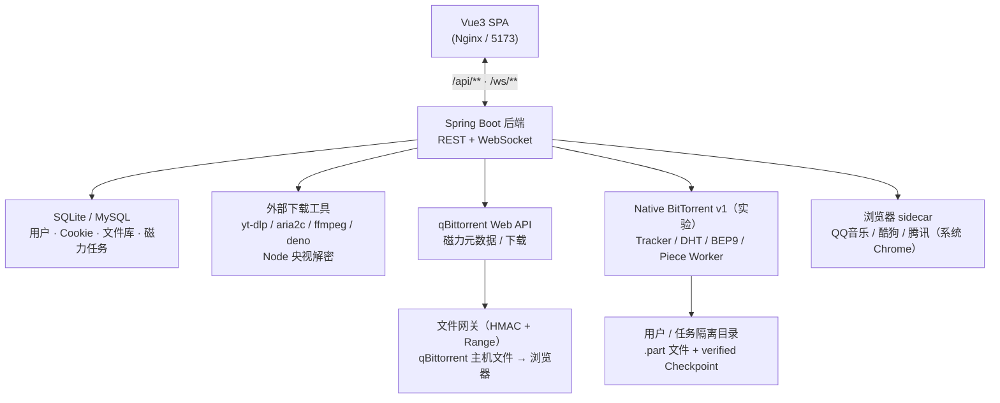
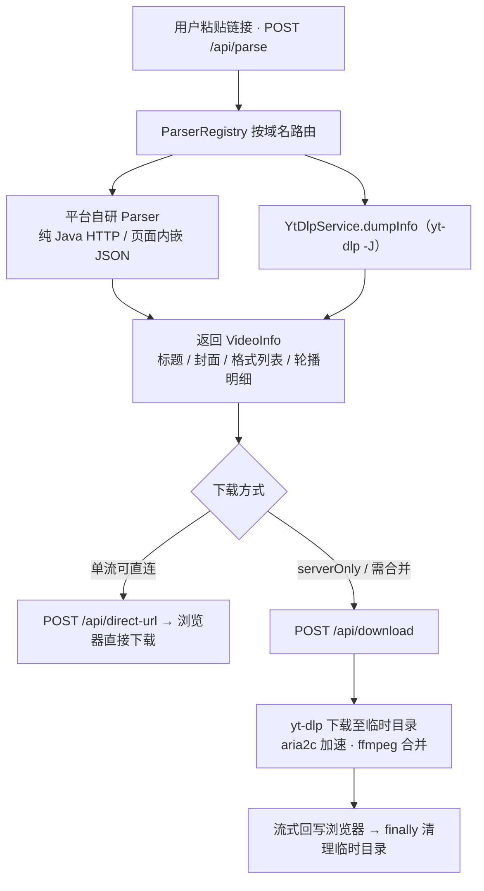
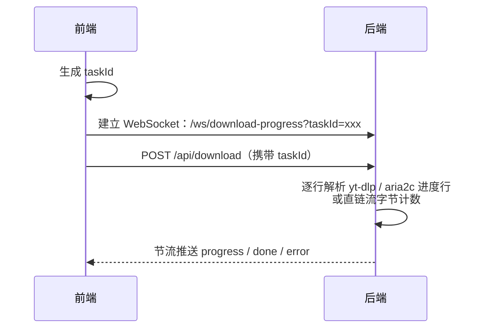
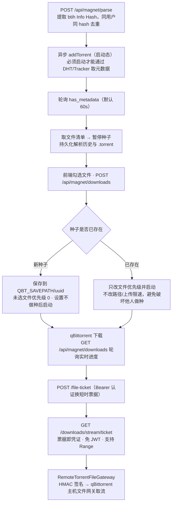
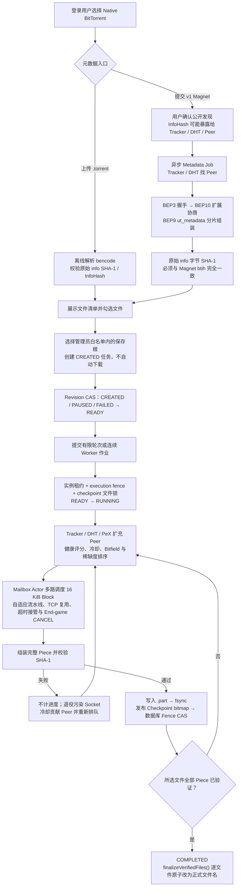
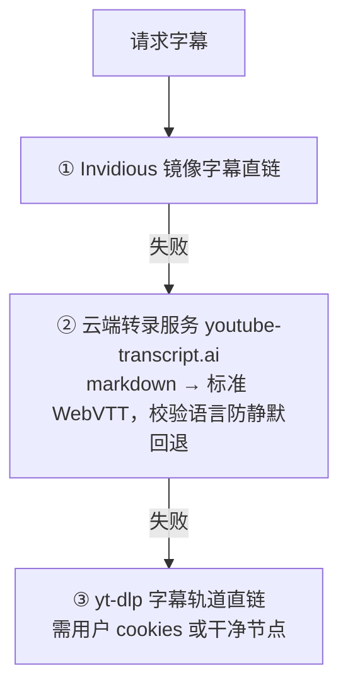
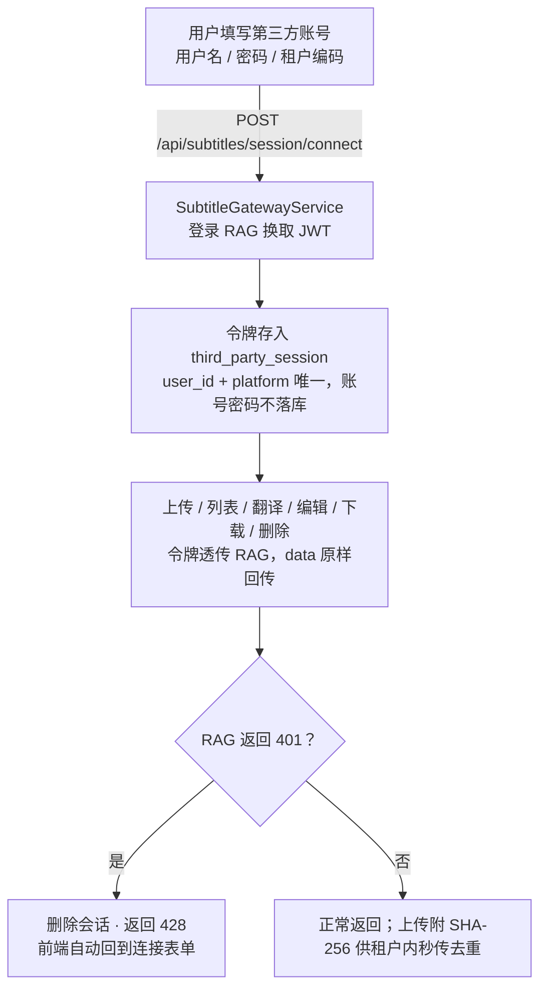

# ClipFetch

一站式多平台媒体解析与下载 Web 应用：粘贴链接即可解析 YouTube / 抖音 / Twitter / TikTok / Bilibili / Instagram / 央视 / BBC / CGTN / 腾讯 / 优酷 / 爱奇艺 / 芒果TV / NetMirror 等视频图文，以及 QQ 音乐 / 网易云 / 酷狗音乐；支持服务端代理下载、无水印下载、多连接加速、WebSocket 实时进度；内置 qBittorrent 磁力下载与实验性纯 Java Native BitTorrent、文件库、预解析库及字幕转换工作台（对接第三方字幕服务完成 SRT / VTT / ASS 上传、LLM 翻译、在线校对与下载）。

## 功能特性

- **多平台视频解析**：YouTube、抖音、Twitter/X、TikTok、Bilibili、Instagram（视频 / 图文 / 轮播）、央视网、BBC、CGTN、Amasian TV、Tubi、微博、小红书、NetMirror（多剧集 / 多清晰度）
- **VIP 视频解析**：腾讯 / 优酷 / 爱奇艺 / 芒果TV 走 VipParser（解析站官方源优先，避免第三方中转水印；腾讯走 TencentBrowserSidecar）
- **音乐解析与下载**：QQ 音乐、网易云音乐、酷狗音乐，歌单 / 专辑 / 搜索结果自动入库「文件库」，FLAC/320k 等品质按平台权益返回
- **磁力下载（qBittorrent）**：qBittorrent Web API 驱动，磁力链接元数据解析、按文件勾选下载、UUID 独立目录、任务暂停 / 恢复 / 删除，下载完成后经文件网关在浏览器取文件
- **Native BitTorrent（实验）**：纯 Java BitTorrent v1 元数据与 Piece 下载链路，支持 Tracker / DHT / PeX / LSD、BEP10/BEP9、多 Peer Mailbox Actor、SHA-1 验证、持久 Checkpoint、暂停续传与任务 Fence；默认关闭且尚未标记为生产就绪
- **两种下载方式**：可直连的直链浏览器下载；被墙 CDN / 需合并的格式走服务端代理下载
- **无水印下载**：抖音无水印直链优先，失败自动回退 yt-dlp
- **下载加速**：aria2c 多连接分片（默认 16 连接），ffmpeg 自动合并音视频
- **实时下载进度**：WebSocket 推送 yt-dlp / aria2c / 直链流的下载进度与速度
- **文件库 / 预解析库**：音乐与解析结果按用户隔离入库，支持分页（单页上限 30）、搜索、重命名、逻辑删除
- **用户 Cookies 管理**：各平台 cookies 上传入库，上传即校验，失效自动标记并引导更新；抖音必须配置 cookies 后使用
- **音乐平台扫码登录**：QQ 音乐 / 酷狗 / 腾讯视频通过本地 Playwright sidecar 拉起系统 Chrome 扫码，登录态持久化在独立 profile 目录
- **央视 h5e 解密**：Node.js + Playwright-core 注入浏览器 WASM 批量解密 TS 段，NAL 单元逐级对齐重试，零掉帧
- **Instagram 轮播展示**：视频 + 图片混合轮播分两栏预览，支持 ZIP 打包下载
- **YouTube 多语言字幕下载**：解析列出全部字幕轨道（中文优先），三级兜底「Invidious 镜像 → 云端转录服务 → yt-dlp(cookies)」
- **字幕转换工作台**：用户用自己的第三方字幕服务账号（用户名/密码/租户编码）连接，上传字幕自动 SHA-256 秒传去重，选择目标语言 LLM 翻译，双栏在线校对后下载 SRT；ClipFetch 仅做登录态网关，字幕数据不本地落库

## 技术栈

| 层 | 技术 | 备注 |
|---|---|---|
| 后端 | Java 21、Spring Boot 3.5.4、MyBatis-Plus 3.5.7、JJWT 0.12.6、BCrypt、Caffeine、Playwright Java 1.63 | Web / WebSocket / Validation starter；仅用 spring-security-crypto 做 BCrypt，不启用 Security 过滤链；Caffeine 做 5 分钟解析结果缓存 |
| 数据库 | SQLite（默认，零依赖）/ MySQL 可选 | Flyway 统一建表迁移，脚本按 `db/migration/sqlite` 与 `db/migration/mysql` 两个目录分别维护，当前版本 V1–V11 |
| 下载引擎 | yt-dlp、aria2c、ffmpeg、deno、Node.js + Playwright-core、Python + Playwright、qBittorrent Web API、纯 Java Native BitTorrent v1 | 各工具用途见下方「各平台与外部工具对应关系」表；qBittorrent 为成熟磁力链路，Native 为显式开关控制的实验链路 |
| 前端 | Vue 3.5 + Vite 6 + Tailwind CSS 3 + axios | 无路由单页；开发端口 5173，`/api` 与 `/ws` 代理到后端 8082 |
| 部署 | 后端单 jar（`app.jar`）+ 前端 Nginx 托管 + Windows 批处理（install / start / uninstall） | 跨机取磁力文件走独立 HMAC 文件网关 |

## 架构说明



后端根包 `cc.ivera`，按限界上下文拆分一级包（每个包内部再按 interfaces / application / domain / infrastructure 分层）：

```
cc.ivera/
├── ClipFetchApplication.java
├── shared/
├── auth/
├── cookie/
├── parser/
├── temp/
├── preparse/
├── magnet/
├── thirdparty/
└── subtitle/
```

## 各平台与外部工具对应关系

| 工具 | 用途 | 覆盖平台 |
|------|------|---------|
| yt-dlp | 解析/下载主管 | YouTube、Twitter、TikTok、抖音、Tubi、AmasianTV（字幕）等 |
| ffmpeg | ① yt-dlp 音视频合并 ② HLS 分片合并 ③ Instagram 首帧封面 | 全部走 yt-dlp 的平台 + 央视、BBC、CGTN、AmasianTV |
| aria2c | yt-dlp 外部下载器，多连接加速渐进式直链 | 抖音、YouTube 渐进式流、NetMirror 等 |
| deno | YouTube BotGuard 挑战 / PO Token | 仅 YouTube |
| Node.js + Playwright | 央视 h5e 批量解密 sidecar | 仅央视网 |
| Python + Playwright sidecar | 真实系统 Chrome 页面签名 / 登录态提取 | QQ音乐（8095）、酷狗（8096）、腾讯视频（8097） |
| 纯 Java 自研 | 逆向站点签名、剧集/清晰度解析、VIP 解析站抓流 | NetMirror、VipParser（腾讯/优酷/爱奇艺/芒果）、网易云/酷狗部分接口 |
| qBittorrent Web API | 磁力元数据与 BT 下载 | 磁力链接 |
| 纯 Java Native BitTorrent v1 | Tracker / DHT / PeX / LSD 发现、BEP10/BEP9 元数据、BEP3 Piece 下载与持久续传 | 实验性 Magnet / `.torrent` 下载，不依赖 qBittorrent |

## 主要流程

### 1. 解析与下载（核心链路）



- 解析结果经 Caffeine 按「用户 ID + 链接」缓存 5 分钟；音乐歌单/搜索/专辑等需写入文件库的解析绕过缓存
- 除登录/注册/刷新及少数由 HTML 标签发起的接口外，全部 `/api/**` 强制登录；音乐、文件库、磁力数据均按 `user_id` 隔离
- 使用用户 cookies 下载报鉴权类错误时，自动把该用户对应平台 cookie 标记为失效

### 2. 下载进度实时推送（WebSocket）



### 3. 磁力下载（qBittorrent）



- qBittorrent 为下载状态唯一事实来源（lazy sync）；删除任务默认保留服务器文件，勾选「同时删除文件」才通知 qBittorrent 删数据
- 不设定时任务：元数据轮询封闭在请求线程/异步池内，进度靠前端轮询时按需回写

### 4. Native BitTorrent（实验）

Native 与 qBittorrent 是互相独立的两套任务链路。前端在「磁力下载」中选择 Native 后，只调用 `/api/magnet/native/**`；它不接管、迁移或修改已有 qBittorrent 种子。当前健康接口明确返回 `productionReady=false`，默认配置也关闭所有真实下载开关；实际公网 Worker 验收状态以 [ISSUE.md](ISSUE.md) 为准。



关键处理规则：

- **元数据可信边界**：只支持 BitTorrent v1。`.torrent` 在本地验证原始 `info` 字典哈希；Magnet 必须通过 BEP9 取得完整 `info`，并再次核对 SHA-1 等于 `btih` 后才能创建任务。共享元数据只接受公开种子，避免私有 Tracker 凭据泄漏。
- **状态机与并发控制**：任务主状态为 `CREATED → READY → RUNNING → PAUSED / COMPLETED / FAILED`。所有变更同时校验 `user_id + task_uuid + revision`；Worker 还绑定实例租约、执行 epoch 和磁盘锁，旧实例或过期页面不能继续提交进度。
- **Peer 与 Block 调度**：开启 `TORRENT_NATIVE_MULTIPLEXED_PEER_MAILBOX_ENABLED` 后，多路 Actor 从共享 Mailbox 领取 Block，坏 Peer 退出后可换租新 Peer；健康评分、稀缺优先、连接复用、超时转移及 End-game 双请求均不得绕过迟到帧/污染 Socket 隔离。
- **发现能力边界**：当前 Worker 自动使用 Torrent Tracker、可选 DHT fallback 和已连接 Peer 的 PeX；BEP14 LSD 协议组件已实现但没有在当前公网 Worker 自动启用，健康接口也标记 discovery acceleration 非自动开启。
- **进度定义**：网络接收字节只记为 `wireBytes`。只有完整 Piece 通过 SHA-1、文件数据已 `fsync`、Checkpoint bitmap 原子发布且数据库 Fence CAS 成功后，才增加 `verifiedBytes`。
- **暂停与恢复**：暂停或取消 Worker 会停止新租约、关闭活动 Socket 并回到 `PAUSED`，已发布的 verified Piece 保留。进程重启或崩溃恢复时重新读取实际文件并逐 Piece 校验，不能只信内存或数据库进度。
- **完成与删除**：所选文件全部 Piece 验证后自动调用 `finalizeVerifiedFiles()`，把 `.clipfetch.part` 收尾为正式文件。删除接口只逻辑删除任务记录，不删除已写入文件；当前前端也尚未提供 Native 文件导出。
- **用户与路径隔离**：所有 API 强制登录并按用户过滤；任务目录按用户和 UUID 隔离。用户只能选择 `TORRENT_NATIVE_DOWNLOAD_ROOT_BASES` 白名单中的目录，符号链接、越界路径和跨用户访问会被拒绝。

### 5. YouTube 字幕三级兜底

出口 IP 被风控时 yt-dlp 各 player client 均可能返回 LOGIN_REQUIRED：



镜像/云端请求先直连，失败且配置了 `PROXY_URL` 时自动经代理重试。

### 6. 字幕转换（第三方登录态网关）

ClipFetch 不保存第三方账号密码，也不在本地落字幕数据：



翻译为 LLM 长耗时操作，网关超时 10 分钟；上传 5 分钟，其余 2 分钟。

## 快速开始（开发）

### 环境依赖

- JDK 21+、Maven 3.9+
- Node.js 18+（前端构建 + 央视解密）
- Python 3.10+（QQ 音乐 / 酷狗 / 腾讯 sidecar）：`pip install playwright`（复用系统 Chrome，无需下载浏览器内核）
- [yt-dlp](https://github.com/yt-dlp/yt-dlp/releases)（必需）、[ffmpeg](https://ffmpeg.org/download.html)（合并必需）
- 可选：[aria2c](https://github.com/aria2/aria2/releases)（多连接加速）、[deno](https://github.com/denoland/deno/releases)（YouTube 反爬）、出站代理、qBittorrent（成熟磁力下载；Native BitTorrent 不依赖它）

```bash
# 后端（默认端口 8082；SQLite 零依赖，首次启动 Flyway 自动建表）
cd backend
mvn spring-boot:run

# 前端
cd frontend
npm install
npm run dev                  # 5173，/api 与 /ws 代理到 8082
```

配置文件：开发期读取 `backend/.env`（同时兼容启动目录 `.env` 与上级目录 `.env`）；根目录提供 `.env.example` 模板。`.env` 优先级高于 `application.yml`，工具路径支持 `%VAR%` 引用系统环境变量。

### 央视解密依赖（首次使用必须）

```bash
cd backend/src/main/resources/cctv
npm install
npx playwright install chromium
```

### VIP 解析依赖（腾讯/优酷/爱奇艺/芒果）

```bash
cd backend
mvn exec:java "-Dexec.mainClass=com.microsoft.playwright.CLI" "-Dexec.args=install chromium"
```

### 音乐 sidecar 的 profile 目录（请勿改名/移动）

QQ 音乐 / 酷狗 / 腾讯首次解析时自动拉起 Python sidecar，在「我的 Cookies」弹窗内扫码登录，登录态持久化在独立 profile 目录（如 `D:/data/qqmusic-profile`，可经 `.env` 配置）。该目录是 Chrome 用户数据目录（含登录 cookie），其中所有文件名由 Chromium 固定，**改名或移动会导致登录态立即失效**；请把整个目录当作黑盒，且不要提交到版本库。

VIP 专属或需单独购买的歌曲，无对应会员账号时服务端返回「无播放权益」，属平台版权限制。

### qBittorrent 磁力下载依赖

1. 安装并启动 qBittorrent，在「选项 → Web UI」中启用 Web UI（建议仅监听 `127.0.0.1` 或内网）
2. 在 `backend/.env` 配置 `qbt-host` / `qbt-user` / `qbt-pass` / `QBT_SAVEPATH`（Docker 部署时填容器内路径）
3. qBittorrent 与后端不在同一台机器时，在 qBittorrent 主机部署文件网关（见 [infra/qbt-file-gateway/windows/README.md](infra/qbt-file-gateway/windows/README.md) 或 [linux 版](infra/qbt-file-gateway/linux/)），并配置 `QBT_FILE_GATEWAY_URL` / `QBT_FILE_GATEWAY_SECRET`

### Native BitTorrent（实验）启用

Native 不需要安装 qBittorrent，但需要本机可写存储目录和对公网 Tracker / DHT / Peer 的网络访问。`application.yml` 中相关开关默认均为 `false`；仅在理解实验边界并准备独立测试目录后，在 `backend/.env` 显式启用：

1. 设置 `TORRENT_NATIVE_ENABLED=true` 与 `TORRENT_NATIVE_STORAGE_ROOT`；需要用户选目录时再配置 `TORRENT_NATIVE_DOWNLOAD_ROOT_BASES` 白名单。
2. 按需开启 `TORRENT_NATIVE_METADATA_LOOKUP_ENABLED`、`TORRENT_NATIVE_TASK_CREATION_ENABLED` 和 `TORRENT_NATIVE_TASK_CONTROL_ENABLED`。
3. 执行真实下载还必须开启 `TORRENT_NATIVE_WORKER_ROUND_ENABLED` 与 `TORRENT_NATIVE_ASYNC_WORKER_ENABLED`；连续模式另开 `TORRENT_NATIVE_CONTINUOUS_WORKER_ENABLED`。
4. 多 Peer Actor、连接复用和稀缺优先分别由 `TORRENT_NATIVE_MULTIPLEXED_PEER_MAILBOX_ENABLED`、`TORRENT_NATIVE_PEER_CONNECTION_REUSE_ENABLED`、`TORRENT_NATIVE_RAREST_FIRST_ENABLED` 控制。完整参数和安全上限见 [.env.example](.env.example)。

修改开关后需重启后端；运行中的任务不会热切换引擎。首次上线应使用新的隔离任务和目录，保留 qBittorrent 作为回退，不要直接接管已有下载。

## 部署

- **Windows 单机**：`install.bat` 写入工具环境变量 → 将 `backend/target/app.jar` 放到项目根目录 → `start.bat` 启动（从根目录启动以保证相对路径一致）；`uninstall.bat` 清理环境变量
- 前端执行 `npm run build` 后由 Nginx 托管静态产物，`/api/` 与 `/ws` 反代到后端；长耗时接口建议 `proxy_read_timeout 3600s`、关闭 `proxy_buffering`
- **跨机磁力文件下载**：qBittorrent 主机部署独立 HTTP 文件网关（HMAC-SHA256 鉴权 + IP 白名单 + Range，支持超 2 GiB 文件），部署说明见 [infra/qbt-file-gateway](infra/qbt-file-gateway/windows/README.md)

## API 一览

| 方法 | 路径 | 认证 | 说明 |
|---|---|---|---|
| POST | `/api/auth/register` / `login` / `refresh` / `logout` | - | 注册、登录（JWT）、刷新、登出 |
| GET | `/api/auth/me` | 需要 | 当前用户信息 |
| POST | `/api/parse` | 需要 | 解析视频/音乐链接 |
| POST | `/api/direct-url` | 需要 | 获取直链（直链下载模式） |
| POST | `/api/download` | 需要 | 服务端代理下载（`taskId` 用于进度推送） |
| POST | `/api/download-subtitle` | 需要 | 独立字幕下载（Amasian TV / YouTube，返回 `.vtt`） |
| GET | `/api/wallpaper` | - | 随机 Bing 每日壁纸（解析结果默认封面） |
| GET | `/api/image-proxy` | - | 图片防盗链代理（如微博图床） |
| GET/POST/DELETE | `/api/cookies`、`/api/cookies/{platform}` | 需要 | cookies 状态 / 上传 / 删除 |
| POST | `/api/qqmusic/login`、`/api/kugou/login`、`/api/tencent/login` | 需要 | sidecar 扫码登录触发 |
| GET | `/api/temp/list`、POST `/api/temp/delete` | 需要 | 文件库分页 / 删除 |
| GET/POST | `/api/pre-parse/list`、`/add`、`/delete`、`/rename`、`/mark-parsed` | 需要 | 预解析库管理 |
| POST/GET | `/api/magnet/parse`、`/api/magnet/parse/{id}` | 需要 | 提交磁力解析（异步）/ 轮询解析结果 |
| GET/DELETE | `/api/magnet/history`、`/api/magnet/history/{id}` | 需要 | 解析历史分页 / 逻辑删除 |
| POST/GET | `/api/magnet/downloads` | 需要 | 创建下载任务（勾选文件）/ 任务进度列表 |
| POST/DELETE | `/api/magnet/downloads/{hash}/start`、`/pause`、`/api/magnet/downloads/{hash}` | 需要 | 开始 / 暂停 / 删除（`deleteFiles` 可选） |
| GET/POST | `/api/magnet/downloads/{hash}/files`、`/file-ticket` | 需要 | 已完成文件清单 / 换取短时下载票据 |
| GET | `/api/magnet/downloads/stream/{ticket}` | 票据 | 浏览器原生下载（免 JWT，支持 Range） |
| GET | `/api/magnet/engine/health` | 需要 | qBittorrent Web API 版本与保存路径 |
| GET | `/api/magnet/native/engine/health` | 需要 | Native 开关、能力与 Worker 可用状态 |
| POST/GET/DELETE | `/api/magnet/native/metadata/jobs/**` | 需要 | 创建、轮询、分页读取或取消 Magnet 元数据任务 |
| POST | `/api/magnet/native/torrent/inspect`、`/api/magnet/native/tasks`、`/api/magnet/native/tasks/from-metadata/{jobId}` | 需要 | 校验 `.torrent`、按文件创建任务或从已验证 BEP9 元数据创建任务 |
| GET/POST/DELETE | `/api/magnet/native/tasks/**` | 需要 | 任务列表、详情、prepare、pause、reconcile、孤儿恢复与逻辑删除 |
| GET/PUT/DELETE | `/api/magnet/native/download-roots/**` | 需要 | 查看、浏览、选择或恢复用户下载根目录 |
| POST/GET/DELETE | `/api/magnet/native/tasks/{taskUuid}/rounds`、`/continuous`、`/api/magnet/native/worker-jobs/**` | 需要 | 提交有限/连续 Worker，查询作业与指标，或取消作业 |
| GET/POST/DELETE | `/api/subtitles/session(/connect)` | 需要 | 第三方字幕服务连接管理 |
| GET/POST/PUT/DELETE | `/api/subtitles/**` | 需要 | 字幕上传 / 历史 / 详情 / 翻译 / 校对 / 删除 / 下载 |
| WS | `/ws/download-progress?taskId=` | - | 下载进度推送 |

统一响应：`{ "success": true, "data": … }` / `{ "success": false, "error": "…" }`。

## 配置项（.env）

| 变量 | 说明 |
|---|---|
| `DB_URL` / `DB_DRIVER` / `DB_USER` / `DB_PASSWORD` | 默认嵌入式 SQLite `jdbc:sqlite:data/fvd.db`（支持相对/绝对路径，目录自动创建）；取消注释 MySQL 段即可切换 |
| `DB_POOL_MAX` / `DB_POOL_MIN` | 连接池大小（SQLite 保持默认，MySQL 建议调大） |
| `JWT_SECRET`、`JWT_ACCESS_EXPIRE_MINUTES`、`JWT_REFRESH_EXPIRE_DAYS` | JWT 密钥与有效期（生产务必改密钥） |
| `SERVER_PORT` | 后端端口（默认 8082） |
| `YTDLP_PATH` / `FFMPEG_LOCATION` / `ARIA2C_PATH` / `JS_RUNTIME_PATH` | yt-dlp / ffmpeg（目录或 exe）/ aria2c / deno 路径 |
| `ARIA2C_CONNECTIONS` | aria2 单服务器连接数（默认 16） |
| `PROXY_URL` | 出站代理（如 `http://127.0.0.1:10808`），被墙平台必需 |
| `YOUTUBE_MIRROR_APIS` | YouTube 兜底 Invidious 镜像（逗号分隔），留空用内置默认 |
| `DOWNLOADS_DIR` / `LOGS_DIR` / `PARSE_TIMEOUT` | 临时下载目录 / 日志目录（按天滚动）/ 解析超时秒数 |
| `NODE_EXE` / `CCTV_DECRYPT_SCRIPT` / `CCTV_DECRYPT_TIMEOUT_MS` | 央视解密 Node 运行时、脚本、超时 |
| `PYTHON_EXE` | sidecar 使用的 Python（默认 `python`） |
| `QQMUSIC_SIDECAR_PORT` / `QQMUSIC_PROFILE_DIR` | QQ 音乐 sidecar 端口（8095）/ Chrome profile 目录 |
| `KUGOU_SIDECAR_PORT` / `KUGOU_PROFILE_DIR` | 酷狗 sidecar（8096）/ profile 目录 |
| `TENCENT_SIDECAR_PORT` / `TENCENT_PROFILE_DIR` | 腾讯视频 sidecar（8097）/ profile 目录 |
| `SUBTITLE_API_BASE_URL` | 第三方字幕转换服务（RAG API）地址；用户在页面上自行连接，无需在此配置账号 |
| `qbt-host` / `qbt-user` / `qbt-pass` | qBittorrent Web UI 地址与账号（端口避开 8082 后端与字幕 RAG） |
| `QBT_SAVEPATH` / `metadata-timeout` | qBittorrent 保存根目录（Docker 内填容器路径）/ 元数据超时秒数（默认 60） |
| `QBT_DOWNLOADS_HOST_DIR` | qBittorrent 下载目录在后端主机上的对应路径（同机部署时使用） |
| `QBT_FILE_GATEWAY_URL` / `QBT_FILE_GATEWAY_SECRET` / `QBT_FILE_GATEWAY_ALLOW_HTTP` | 跨机文件网关地址 / HMAC 共享密钥 / 是否允许 HTTP（仅本机测试可 true） |
| `TORRENT_NATIVE_ENABLED` / `TORRENT_NATIVE_STORAGE_ROOT` / `TORRENT_NATIVE_DOWNLOAD_ROOT_BASES` | Native 总开关、默认存储根与用户可选目录白名单；默认关闭 |
| `TORRENT_NATIVE_METADATA_LOOKUP_ENABLED` / `TORRENT_NATIVE_TASK_CREATION_ENABLED` / `TORRENT_NATIVE_TASK_CONTROL_ENABLED` | Magnet 元数据、任务创建与任务控制门禁 |
| `TORRENT_NATIVE_WORKER_ROUND_ENABLED` / `TORRENT_NATIVE_ASYNC_WORKER_ENABLED` / `TORRENT_NATIVE_CONTINUOUS_WORKER_ENABLED` | 有限轮次、异步 Worker 与连续下载门禁 |
| `TORRENT_NATIVE_PARALLEL_PIECE_WORKERS` / `TORRENT_NATIVE_COMMIT_GROUP_PIECES` / `TORRENT_NATIVE_NETWORK_ROUND_BUDGET_MILLIS` | Piece 并发上限、持久化组大小与单轮网络预算 |
| `TORRENT_NATIVE_MULTIPLEXED_PEER_MAILBOX_ENABLED` / `TORRENT_NATIVE_PEER_CONNECTION_REUSE_ENABLED` / `TORRENT_NATIVE_RAREST_FIRST_ENABLED` | Mailbox Actor、多轮 TCP 复用与稀缺 Piece 优先 |
| `TORRENT_NATIVE_INSTANCE_HEARTBEAT_ENABLED` / `TORRENT_NATIVE_SINGLE_INSTANCE_ORPHAN_RECOVERY_ENABLED` | Worker 实例租约与单实例孤儿恢复；多实例环境禁止误用单实例恢复 |

## 安全注意事项

- `.env`、cookies 文件、各 sidecar 的 profile 目录均已列入 `.gitignore`，严禁提交（含登录态与密钥）
- 生产部署请更换 `JWT_SECRET` 与文件网关 `QBT_FILE_GATEWAY_SECRET`（32 字符以上随机串）、限制 CORS 来源
- 磁力浏览器下载走「短时一次性票据」而非 URL 带 JWT：票据绑定用户 / 任务 / 文件，每次请求重新校验任务归属、保存路径与文件完成状态；文件网关端口不要对整个公网开放，跨机部署务必配置 IP 白名单
- qBittorrent Web UI 建议仅监听 `127.0.0.1` 或内网，不对公网开放
- Native 的 Magnet 公开发现会向 Tracker / DHT / Peer 暴露 InfoHash，必须由用户显式确认；生产环境继续以健康接口的 `productionReady` 和 [ISSUE.md](ISSUE.md) 的真实验收状态为准
- Native 存储根和用户可选目录必须位于受控白名单，禁止通过符号链接、目录穿越或手工改数据库绕过路径校验
