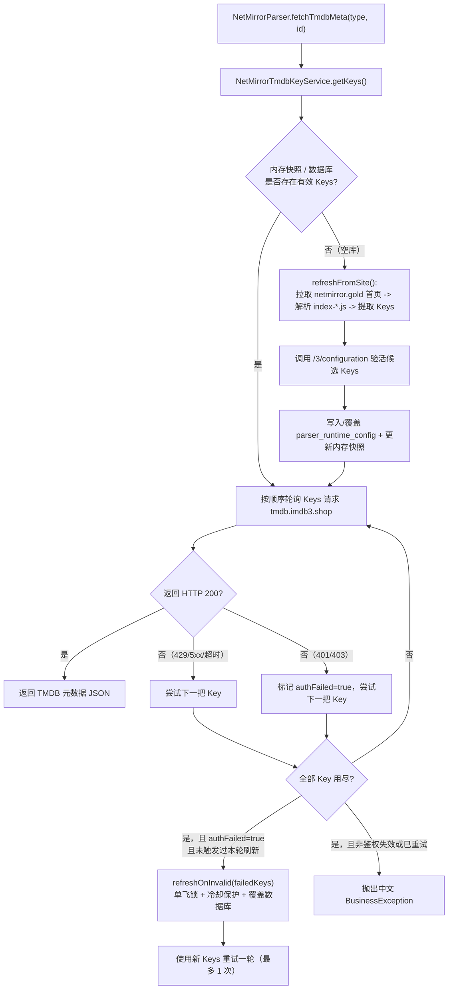

# NetMirror TMDB Key 动态提取、持久化与失效覆盖 实施计划

> 日期：2026-11-24（Asia/Shanghai）
> 状态：Plan-only，尚未实施
> 仓库：D:\release\clipfetch
> 依据：AGENTS.md、HANDOFF.md，以及对 `NetMirrorParser.java`、`V27__playback_progress.sql`、`https://netmirror.gold` 前端脚本的实际核查
> 实施纪律：本轮只输出实施计划，不修改业务代码、不执行构建、不启动服务、不创建 commit

---

## 1. 背景与目标

当前 [NetMirrorParser.java](../../../backend/src/main/java/cc/ivera/parser/application/parser/video/NetMirrorParser.java) 中用于请求 `https://tmdb.imdb3.shop/3/{type}/{id}` 的 `TMDB_KEYS` 是静态硬编码的两个 Key（提取自 NetMirror 官网前端 JS）。一旦原站轮换 Key，会导致 `/tmdb/watch/` 解析返回 `HTTP 401`，必须改代码重新编译。

### 目标与验收标准

1. **数据库持久化**：在数据库中保存当前生效的 NetMirror TMDB Key 列表、来源与刷新/校验时间戳（同时支持 SQLite 与 MySQL）。
2. **冷启动自动获取保存**：解析请求读取数据库时，若无记录或列表为空，自动通过 HTTP 请求 NetMirror 官网入口页与前端 JS bundle，提取 TMDB Key 列表、验活并落库。
3. **失效自动检测与覆盖**：解析调用 TMDB 接口时，若库中全部 Key 均触发鉴权失效（`HTTP 401` / `403`），自动触发一次防抖/单飞刷新：重新抓取官网最新 JS、提取并验活新 Key、**覆盖更新数据库**，随后自动重试当前解析请求（单次解析最多自动刷新重试 1 轮，防止死循环）。
4. **配套 REST 管理接口**：提供受登录鉴权保护的后端接口，支持查看当前 Key 状态（脱敏）、手动触发重新抓取并覆盖、以及手动覆盖自定义 TMDB Key（作为原站大幅改版/加混淆时的兜底方案）。
5. **合规约束**：
   - 使用纯 JDK `HttpClient`（遵循 `AGENTS.md`，不引入新 HTTP 客户端）；
   - SQL 全部写在 `resources/mapper/*.xml`，不使用 MyBatis 注解写 SQL；
   - Flyway 双库同版本号迁移（`V28`），保留逻辑删除字段；
   - 新增接口走 `/api/netmirror/**` 且强制 JWT 登录，不加入 `WebConfig` 白名单；
   - 所有新增/改动文本文件均为无 BOM UTF-8；日志与接口不打印/回传完整明文 Key。

---

## 2. 整体架构与数据流

---

## 3. 数据库设计（Flyway V28）

当前最新迁移版本已核对为 `V27__playback_progress.sql`，本次新增 `V28` 双库迁移脚本：

- `backend/src/main/resources/db/migration/sqlite/V28__parser_runtime_config.sql`
- `backend/src/main/resources/db/migration/mysql/V28__parser_runtime_config.sql`

### 表结构：`parser_runtime_config`

作为系统级解析运行态配置表（非用户个人数据，全局共享），通过 `config_key` 区分配置项（本次为 `netmirror.tmdb_keys`），后续如需动态持久化 `netmirror.sig_key` 或其他平台公开参数可直接复用，无需重复建表。

| 字段 | SQLite 类型 | MySQL 类型 | 说明 |
|---|---|---|---|
| `id` | `INTEGER PRIMARY KEY AUTOINCREMENT` | `BIGINT PRIMARY KEY AUTO_INCREMENT` | 主键 |
| `config_key` | `VARCHAR(128) NOT NULL` | `VARCHAR(128) NOT NULL` | 配置键，如 `netmirror.tmdb_keys` |
| `config_value` | `TEXT NOT NULL` | `TEXT NOT NULL` | JSON 数组字符串，如 `["k1","k2"]` |
| `source` | `VARCHAR(32) NOT NULL` | `VARCHAR(32) NOT NULL` | 来源：`AUTO_FETCH` / `MANUAL` |
| `source_url` | `VARCHAR(512)` | `VARCHAR(512) NULL` | 自动提取时的前端 JS 地址，便于排查 |
| `last_verified_at` | `DATETIME` | `DATETIME NULL` | 最近一次校验可用时间 |
| `last_refreshed_at` | `DATETIME` | `DATETIME NULL` | 最近一次抓取/覆盖时间 |
| `created_at` | `DATETIME NOT NULL DEFAULT CURRENT_TIMESTAMP` | `DATETIME NOT NULL DEFAULT CURRENT_TIMESTAMP` | 创建时间 |
| `updated_at` | `DATETIME NOT NULL DEFAULT CURRENT_TIMESTAMP` | `DATETIME NOT NULL DEFAULT CURRENT_TIMESTAMP ON UPDATE CURRENT_TIMESTAMP` | 更新时间 |
| `deleted` | `BIGINT NOT NULL DEFAULT 0` | `BIGINT NOT NULL DEFAULT 0` | 逻辑删除：`0=正常`，非 0 写记录 `id` |

- 唯一索引：`UNIQUE (config_key, deleted)`（`uk_parser_runtime_config_key`）。

---

## 4. 后端模块与文件改动清单

### 4.1 领域与持久层（`cc.ivera.parser.domain` + `mapper/*.xml`）

1. **新增实体**：`backend/src/main/java/cc/ivera/parser/domain/ParserRuntimeConfig.java`
   - `@TableName("parser_runtime_config")` + `@Getter @Setter @Builder @NoArgsConstructor @AllArgsConstructor`
   - `@TableId(type = IdType.AUTO)`、`@TableLogic private Long deleted`、`LocalDateTime` 时间字段。
2. **新增 Mapper 接口**：`backend/src/main/java/cc/ivera/parser/domain/ParserRuntimeConfigMapper.java`
   - 位于 `cc.ivera.parser.domain`，自动被 `@MapperScan("cc.ivera.**.domain")` 扫描，无需 `@Mapper`。
   - 方法：`findByKey`、`insertConfig`、`updateConfig`、`logicalDeleteById`。
3. **新增 XML**：`backend/src/main/resources/mapper/ParserRuntimeConfigMapper.xml`
   - 全部 SQL 放 XML，覆盖写入采用「锁内 `findByKey` → 无则 `insertConfig`、有则 `updateConfig`」，天然兼容 SQLite 与 MySQL 方言，不依赖数据库特有 `UPSERT` 语法。

### 4.2 核心服务：`NetMirrorTmdbKeyService`

- **新增类**：`backend/src/main/java/cc/ivera/parser/application/parser/video/NetMirrorTmdbKeyService.java`
- **关键职责与实现要点**：
  1. **入口 JS 抓取（纯 JDK `HttpClient`）**：
     - 复用 `app.parse-timeout` 与 `app.proxy` 配置；
     - `GET {siteOrigin}/` → 匹配入口模块脚本 `<script[^>]+type=["']module["'][^>]+src=["']([^"']+\.js)["']`（同时兼容 `src` 与 `type` 属性顺序互换），用 `URI.resolve(...)` 构造绝对 JS URL；
     - `GET {jsUrl}` 拉取 JS bundle 文本。
  2. **抗混淆的 Key 提取策略（不依赖短变量名如 `Gm` / `Ym`）**：
     - **策略 A（上下文锚定）**：定位 `tmdb.imdb3.shop` 出现位置，取前 1500 字符至后 500 字符窗口，正则匹配 32 位十六进制字符串数组字面量 `\[(?:\s*["'][0-9a-fA-F]{32}["']\s*,?)+\]`，按序去重提取所有 Key；
     - **策略 B（兜底扫描）**：若策略 A 未命中，扫描全文中 2 个及以上 32 位十六进制字符串组成的数组候选，后续交由验活步骤筛选真实 TMDB Key。
  3. **验活后覆盖保护**：
     - 对提取出的候选 Key 逐个调用轻量只读接口 `GET https://tmdb.imdb3.shop/3/configuration?api_key={key}`；
     - 仅保留返回 `200`（或 `429` 临时限流，表示 Key 本身有效）的 Key，过滤掉 `401`/`403`；
     - 若过滤后为空，拒绝覆盖数据库，抛出清晰中文 `BusinessException`（避免原站改版抽出垃圾串把库里尚可用的配置覆盖破坏）。
  4. **并发单飞 + 防抖冷却**：
     - `private volatile KeySnapshot cachedSnapshot` 做内存只读快照，正常解析不频繁查库；
     - `private final ReentrantLock refreshLock = new ReentrantLock()` 控制刷新并发：
       - 多线程同时触发失效刷新时，后进入锁的线程先比对 `cachedSnapshot.keys` 与 `failedKeys`：若已被前一个线程更新，直接返回新列表；
       - 记录最近一次自动抓取时间，默认冷却 `60` 秒（手动调 `/refresh` 接口可绕过冷却强制刷新），避免异常期间反复下载 ~780KB JS。
  5. **脱敏视图与手动覆盖**：
     - 对外状态视图仅暴露脱敏 Key（如 `c8de****f7ad`）、`count`、`source`、`sourceUrl`、`lastRefreshedAt`、`lastVerifiedAt`；
     - 手动覆盖支持传入 `keys`（`jakarta.validation` 校验非空且每项匹配 `^[0-9a-fA-F]{32}$`）与 `verify`（默认 `true`，先验活再覆写，`source = MANUAL`）。

### 4.3 改造 `NetMirrorParser`

- **修改文件**：`backend/src/main/java/cc/ivera/parser/application/parser/video/NetMirrorParser.java`
  - 移除硬编码的 `TMDB_KEYS` 常量，构造注入 `NetMirrorTmdbKeyService`；
  - 重构 `fetchTmdbMeta(String type, String id)`：
    - 第一轮使用 `tmdbKeyService.getKeys()`（空库会自动抓取并落库）依次请求；
    - 精确区分响应状态：`200` 直接返回；`401`/`403` 标记 `authFailed = true`；`429` 仅切下一把 Key 不误判为 Key 永久失效；
    - 若第一轮全部失败且 `authFailed == true`，调用 `tmdbKeyService.refreshOnInvalid(keys)` 重新抓取并覆盖数据库，再用新列表执行第二轮请求（仅此 1 次重试）；
    - 全过程日志仅输出脱敏 Key（如 `c8de****f7ad`）与 HTTP 状态码。

### 4.4 REST 管理接口：`NetMirrorConfigController`

- **新增类**：`backend/src/main/java/cc/ivera/parser/interfaces/NetMirrorConfigController.java`
- `@RestController` + `@RequestMapping("/api/netmirror/tmdb-keys")`，统一返回 `ApiResponse.ok(...)`，异常抛 `BusinessException`，**不加入免登录白名单**。

| 方法与路径 | 说明 | 请求体 / 返回要点 |
|---|---|---|
| `GET /api/netmirror/tmdb-keys` | 查看当前库中保存的 TMDB Key 状态 | 返回 `{ configured, count, maskedKeys, source, sourceUrl, lastRefreshedAt, lastVerifiedAt }` |
| `POST /api/netmirror/tmdb-keys/refresh` | 立即从 NetMirror 官网抓取 JS、提取验活并覆盖数据库 | 无请求体，返回刷新后的最新脱敏状态 |
| `PUT /api/netmirror/tmdb-keys` | 手动写入/覆盖 TMDB Key 列表（兜底用） | `{ "keys": ["<32位hex>"], "verify": true }`，校验通过后覆盖落库并标记 `source=MANUAL` |

### 4.5 可选配置项（待确认）

建议将以下两项放入 `application.yml` 占位符并同步到 `.env`、`backend/.env`、`.env.example` 三处（遵循 `AGENTS.md` 三处键名完全一致约定）：

- `NETMIRROR_SITE_ORIGIN=https://netmirror.gold`（今后 NetMirror 再换域名无需改 Java 代码，改 `.env` 重启即可）
- `NETMIRROR_TMDB_REFRESH_COOLDOWN_SECONDS=60`（自动失效刷新的最小冷却秒数）

---

## 5. 风险与边界处理

| 场景 | 处理策略 |
|---|---|
| NetMirror 首页或 JS bundle 临时网络波动/超时 | 保持数据库中既有记录不被覆盖，抛出明确中文 `BusinessException` 提示用户稍后重试或通过 `PUT` 手动配置 |
| TMDB 接口仅报 `429` 限流（Key 本身未失效） | 先自动轮询下一把 Key，不把 `429` 当作 `401` 失效去反复拉 JS 覆盖库 |
| 高并发解析同时命中空库或 `401` 失效 | `ReentrantLock` 单飞 + 双检比对 `failedKeys`，保证只发起 1 次官网抓取与 1 次写库 |
| SQLite 写锁竞争 | 写库操作集中在刷新锁内串行执行，且正常解析只读内存快照，不会增加 SQLite 并发写压力 |
| 原站彻底更换前端结构或混淆导致正则提不到 Key | 验活阶段拦下空结果不污染库，运维/用户可通过 `PUT /api/netmirror/tmdb-keys` 手动填入自有 TMDB v3 API Key 立即恢复服务 |

---

## 6. 实施步骤与验证计划

### 实施顺序
1. 新增 `V28__parser_runtime_config.sql`（SQLite 与 MySQL 双库）。
2. 如确认纳入 `.env`，同步更新 `.env`、`backend/.env`、`.env.example` 与 `application.yml` 并校验三处键名集合完全相等。
3. 新增 `ParserRuntimeConfig`、`ParserRuntimeConfigMapper` 与 `ParserRuntimeConfigMapper.xml`。
4. 新增 `NetMirrorTmdbKeyService` 并改造 `NetMirrorParser.fetchTmdbMeta`。
5. 新增 `NetMirrorConfigController`。
6. 执行编译与端到端实测验证。

### 验证清单
- `mvn -q clean compile -DskipTests` 编译通过（Exit Code `0`）；
- 所有新增/修改文件经 `Format-Hex` 校验为无 BOM UTF-8；
- 启动后端 `8082` 后实测 4 个用例：
  1. **空库自动获取保存**：确认库中无 `netmirror.tmdb_keys` 记录 → 解析 `https://netmirror.gold/tmdb/watch/movie/550` → 验证自动拉取 JS 提取 Key 并写入数据库；
  2. **查询接口**：`GET /api/netmirror/tmdb-keys` 返回脱敏 Key、`source=AUTO_FETCH` 与 `sourceUrl`；
  3. **失效自动覆盖**：通过 `PUT /api/netmirror/tmdb-keys`（`verify=false`）写入假 Key `00000000000000000000000000000000` → 再次解析 `/tmdb/watch/movie/550` → 验证命中 `401` 后自动重新抓取覆盖数据库并解析成功；
  4. **手动刷新与校验拦截**：调用 `POST /api/netmirror/tmdb-keys/refresh` 成功覆盖；调用 `PUT` 传入无效 Key 且 `verify=true` 时被拒绝且不破坏原数据。
